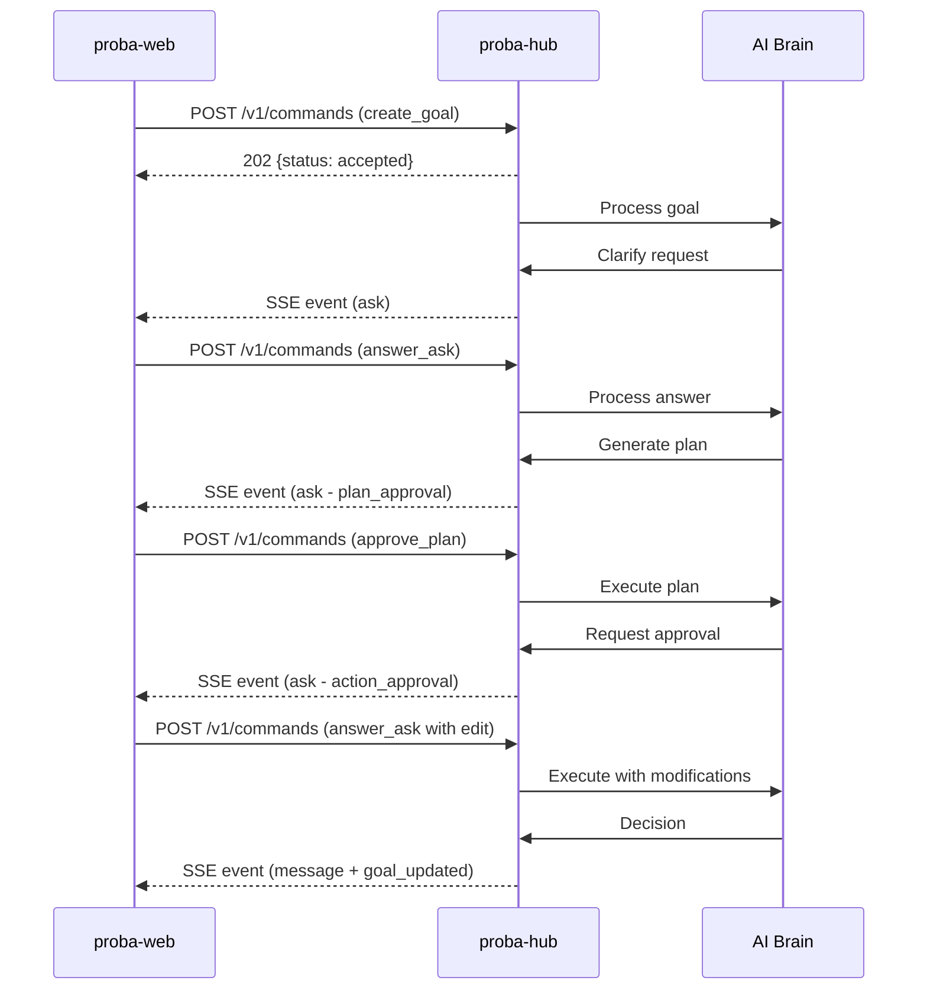

# @smallseedlabs/proba-protocol

Shared protocol library for **Proba** - an AI-native platform for testing products with ads.

This library defines the complete communication contract between the Proba client (proba-web) and the Interaction Hub (proba-hub), including TypeScript types, JSON Schema definitions, and runtime validation.

## Overview

Proba uses a structured protocol where an LLM "brain" operates within fixed guardrail code. The protocol defines how commands flow from client to server and how events flow back, with server-driven UI components for rich client rendering.

### Architecture



## Installation

### From npm (GitHub Packages)

```bash
npm install @smallseedlabs/proba-protocol
```

Configure `.npmrc` to use GitHub Packages:

```
@smallseedlabs:registry=https://npm.pkg.github.com
```

### From Git Repository

```bash
npm install github:smallseedlabs/proba-protocol#v0.1.0
```

Or in `package.json`:

```json
{
  "dependencies": {
    "@smallseedlabs/proba-protocol": "github:smallseedlabs/proba-protocol#v0.1.0"
  }
}
```

## Usage

### TypeScript Types

```typescript
import type {
  CommandEnvelope,
  EventEnvelope,
  SendMessagePayload,
  AskPayload
} from '@smallseedlabs/proba-protocol';

// Build and send a command
import { buildSendMessageCommand } from '@smallseedlabs/proba-protocol';

const command = buildSendMessageCommand({
  text: 'Create a campaign for our new product'
});
```

### Runtime Validation

```typescript
import {
  commandEnvelopeSchema,
  validateCommandPayload
} from '@smallseedlabs/proba-protocol';

// Validate a command envelope
const result = commandEnvelopeSchema.safeParse(receivedCommand);
if (!result.success) {
  console.error('Invalid command:', result.error);
}

// Validate specific payload
const isValid = validateCommandPayload('send_message', payload);
```

### Type Guards

```typescript
import { isCommandEnvelope, isEventEnvelope } from '@smallseedlabs/proba-protocol';

if (isCommandEnvelope(data)) {
  // TypeScript knows data is CommandEnvelope
  console.log(data.clientMsgId);
}
```

### Brain Output Mapping

```typescript
import { mapBrainOutputToEvent } from '@smallseedlabs/proba-protocol';
import type { BrainReply } from '@smallseedlabs/proba-protocol';

const brainReply: BrainReply = {
  type: 'reply',
  text: 'I understand. Let me create a plan.'
};

const event = mapBrainOutputToEvent(brainReply, {
  seq: 5,
  threadId: 'thread-123'
});
```

### JSON Schema (Non-TypeScript Clients)

```javascript
const schemas = require('@smallseedlabs/proba-protocol/schemas');

// Use with your JSON Schema validator
validate(data, schemas.definitions.CommandEnvelope);
```

## Transport Contract

### REST Endpoint: Commands

**POST `/v1/commands`**

Submit a command from client to server. Returns immediately with acceptance status.

**Request:** Command envelope (JSON)

**Response:** `202 Accepted`
```json
{
  "status": "accepted",
  "clientMsgId": "550e8400-e29b-41d4-a716-446655440000"
}
```

or `202` with rejection:
```json
{
  "status": "rejected",
  "clientMsgId": "550e8400-e29b-41d4-a716-446655440000",
  "reason": "validation_error"
}
```

### SSE Stream: Events

**GET `/v1/events`**

Server-Sent Events stream with automatic reconnection via `Last-Event-ID`.

**Headers:**
- `Last-Event-ID: <seq>` - Resume from sequence number

**Stream format:**
```
id: 1
event: message
data: {"kind":"event","seq":1,"type":"message",...}

id: 2
event: ask
data: {"kind":"event","seq":2,"type":"ask",...}
```

Heartbeats are sent every 30 seconds to maintain the connection.

### Polling Fallback

**GET `/v1/events?after=<seq>`**

Poll for events after a given sequence number.

**Response:**
```json
{
  "events": [...],
  "nextSeq": 5,
  "hasMore": false
}
```

## Protocol Components

### Commands (Client → Server)

| Type | Description | Payload |
|------|-------------|---------|
| `send_message` | Send a text message with optional attachments | `SendMessagePayload` |
| `answer_ask` | Answer a question (approve/reject/edit) | `AnswerAskPayload` |
| `create_goal` | Create a new campaign goal | `CreateGoalPayload` |
| `approve_plan` | Approve or reject a plan | `ApprovePlanPayload` |
| `control` | Control execution (pause/resume/kill) | `ControlPayload` |
| `explain` | Request explanation for a decision | `ExplainPayload` |
| `mark_read` | Mark events as read up to sequence | `MarkReadPayload` |

### Events (Server → Client)

| Type | Description | Payload |
|------|-------------|---------|
| `message` | Text message from brain or system | `MessagePayload` |
| `ask` | Question requiring user input | `AskPayload` |
| `ask_resolved` | Resolution of a previous ask | `AskResolvedPayload` |
| `status` | Current system status | `StatusPayload` |
| `alert` | User alert or notification | `AlertPayload` |
| `goal_updated` | Goal progress or metrics updated | `GoalUpdatedPayload` |
| `ack` | Command acknowledgment | `AckPayload` |
| `error` | Error occurred | `ErrorPayload` |

### Server-Driven UI Components

Events can include a `ui` field with a component specification for rich rendering:

- **text** - Formatted text with markdown support
- **plan_card** - Multi-step plan with cost estimates
- **approval_card** - Action approval with before/after comparison
- **question_choice** - Multiple choice question
- **question_text** - Free-text input
- **metric_tile** - Single metric with trend
- **metric_chart** - Time-series chart
- **table** - Tabular data
- **spend_bar** - Budget vs spend progress bar
- **status_banner** - Current system status
- **alert** - Dismissible alert
- **timeline_item** - Timeline entry
- **goal_summary** - Goal overview with metrics
- **form** - Multi-field form
- **number_input** - Numeric input with constraints
- **select** - Dropdown selection
- **confirm** - Confirmation dialog

Clients must gracefully fall back to `fallbackText` for unknown components or versions.

## Examples

See [`examples/happy-path-conversation.json`](./examples/happy-path-conversation.json) for a complete conversation flow demonstrating:

1. Goal creation
2. Clarification question
3. Plan approval
4. Action approval with edit (+20% → +10%)
5. Decision with evidence

## Development

```bash
# Install dependencies
npm install

# Build
npm run build

# Run tests
npm test

# Run tests in watch mode
npm run test:watch

# Lint
npm run lint

# Type check
npm run typecheck

# Run all validations
npm run validate
```

## Contributing

See [CONTRIBUTING.md](./CONTRIBUTING.md) for guidelines.

## Versioning

This project follows [Semantic Versioning](https://semver.org/):

- **Major**: Breaking changes to the protocol
- **Minor**: New features, backward-compatible
- **Patch**: Bug fixes, backward-compatible

Current version: **0.1.0** (initial release)

## License

Apache-2.0 © Small Seed Labs

See [LICENSE](./LICENSE) for full license text.

---

**Related Projects:**
- [proba-hub](https://github.com/smallseedlabs/proba-hub) - Interaction Hub (protocol service)
- [proba-web](https://github.com/smallseedlabs/proba-web) - Client UI

For questions, please open an issue on GitHub.
