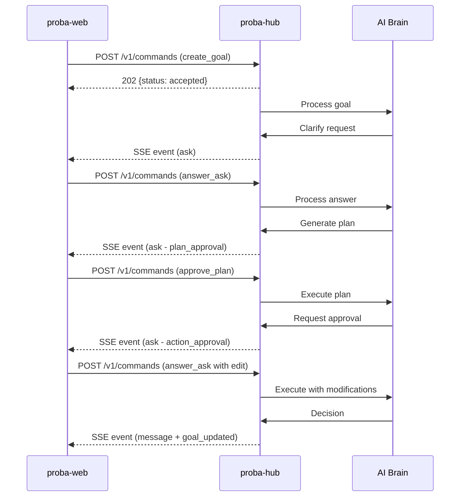

# @smallseedlabs/proba-protocol

Shared protocol library for **Proba** - an AI-native platform for testing products with ads.

This library defines the complete communication contract between the Proba client (proba-web) and the Interaction Hub (proba-hub), including TypeScript types, JSON Schema definitions, and runtime validation.

## Overview

Proba uses a structured protocol where an LLM "brain" operates within fixed guardrail code. The protocol defines how commands flow from client to server and how events flow back, with server-driven UI components for rich client rendering.

### Architecture



## Installation

### From npm (GitHub Packages)

```bash
npm install @smallseedlabs/proba-protocol
```

Configure `.npmrc` to use GitHub Packages:

```
@smallseedlabs:registry=https://npm.pkg.github.com
```

### From Git Repository

```bash
npm install github:smallseedlabs/proba-protocol#v0.1.0
```

Or in `package.json`:

```json
{
  "dependencies": {
    "@smallseedlabs/proba-protocol": "github:smallseedlabs/proba-protocol#v0.1.0"
  }
}
```

## Usage

### TypeScript Types

```typescript
import type {
  CommandEnvelope,
  EventEnvelope,
  SendMessagePayload,
  AskPayload
} from '@smallseedlabs/proba-protocol';

// Build and send a command
import { buildSendMessageCommand } from '@smallseedlabs/proba-protocol';

const command = buildSendMessageCommand({
  text: 'Create a campaign for our new product'
});
```

### Runtime Validation

```typescript
import {
  commandEnvelopeSchema,
  validateCommandPayload
} from '@smallseedlabs/proba-protocol';

// Validate a command envelope
const result = commandEnvelopeSchema.safeParse(receivedCommand);
if (!result.success) {
  console.error('Invalid command:', result.error);
}

// Validate specific payload
const isValid = validateCommandPayload('send_message', payload);
```

### Type Guards

```typescript
import { isCommandEnvelope, isEventEnvelope } from '@smallseedlabs/proba-protocol';

if (isCommandEnvelope(data)) {
  // TypeScript knows data is CommandEnvelope
  console.log(data.clientMsgId);
}
```

### Brain Output Mapping

```typescript
import { mapBrainOutputToEvent } from '@smallseedlabs/proba-protocol';
import type { BrainReply } from '@smallseedlabs/proba-protocol';

const brainReply: BrainReply = {
  type: 'reply',
  text: 'I understand. Let me create a plan.'
};

const event = mapBrainOutputToEvent(brainReply, {
  seq: 5,
  threadId: 'thread-123'
});
```

### JSON Schema (Non-TypeScript Clients)

```javascript
const schemas = require('@smallseedlabs/proba-protocol/schemas');

// Use with your JSON Schema validator
validate(data, schemas.definitions.CommandEnvelope);
```

## Audit and Metrics Contract

Every Proba service logs every action to a global audit trail, and ad-platform numbers are normalised into one shape. The contract for both lives here. Like the rest of this package it is I/O-free: schemas, types, builders and validators only. There is no database, bus or network code; services bring their own.

Import from the package root or from the dedicated subpath:

```typescript
import {
  buildAuditEvent,
  validateAuditEvent,
  isAuditEvent,
  AUDIT_ACTIONS,
  validateMetricObservation,
} from '@smallseedlabs/proba-protocol/audit';
```

### AuditEvent (version 1)

Producers emit `AuditEvent`s. The audit consumer stores them as `StoredAuditEvent`s.

```typescript
const event = buildAuditEvent({
  traceId: command.clientMsgId, // root of the trace: the web command's clientMsgId, or a job run id
  workspaceId: 'default',
  userId,
  threadId,
  actor: { type: 'user', id: userId },
  service: 'hub',
  action: 'command.received', // dotted, lower-case
  category: 'command',
  outcome: 'success',
  details: { commandType: command.type },
});
// buildAuditEvent fills version, eventId, spanId, occurredAt and details when omitted.

const result = validateAuditEvent(event); // zod SafeParseReturnType
if (!result.success) console.error(result.error.issues);
```

| Field | Type | Required | Notes |
|-------|------|----------|-------|
| `version` | `1` | yes | Defaulted by `buildAuditEvent` |
| `eventId` | uuid | yes | Producer-generated; the consumer dedupes on it |
| `traceId` | uuid | yes | Groups everything caused by one root |
| `spanId` | string (1-64) | yes | Defaulted to 16 hex chars by `buildAuditEvent` |
| `parentSpanId` | string (1-64) | no | Absent on the root span |
| `workspaceId` | string | yes | |
| `userId` | uuid | no | |
| `goalId` / `threadId` | uuid | no | |
| `campaignId` | string | no | Not a uuid: may be a platform id |
| `actor` | `{ type: 'user' \| 'brain' \| 'system' \| 'service', id: string }` | yes | |
| `service` | string | yes | Emitting service, e.g. `hub` |
| `action` | string | yes | Dotted lower-case, at least two segments, e.g. `brain.llm_call` |
| `category` | `command` \| `brain` \| `tool` \| `policy` \| `approval` \| `data_access` \| `memory` \| `metrics` \| `auth` \| `config` \| `system` | yes | |
| `target` | `{ type: string, id: string }` | no | |
| `outcome` | `success` \| `failure` \| `denied` \| `partial` | yes | |
| `errorCode` / `errorMessage` | string | no | |
| `riskLevel` | `low` \| `medium` \| `high` | no | |
| `cost` | `{ tokensIn?, tokensOut?, currency?, amount? }` | no | `currency` (3 letters) and `amount` go together |
| `durationMs` | number >= 0 | no | |
| `occurredAt` | ISO 8601 datetime | yes | When the action happened; defaulted to now |
| `details` | `Record<string, unknown>` | yes | Defaulted to `{}`. See the rule below |
| `tags` | string[] | no | |

**Rule for `details`: no secrets and no raw personal data.** Never put API keys, tokens, passwords, cookies, auth headers or platform credentials in an audit event, and refer to people and records by id, not by name, email or free text. This rule is documentation only: validation does not inspect keys or values, so producers are responsible for it.

`AUDIT_ACTIONS` lists recommended action names per category (for example `command.received`, `policy.denied`). It is a suggestion, not an allow-list: any dotted lower-case action validates.

**Stored form.** `StoredAuditEvent` extends `AuditEvent` with `prevHash` (`string | null`, null for the first event), `hash`, `ingestedAt` and `schemaVersion`. Producers never set these; the audit consumer adds them when it appends the event to the hash chain. `canonicalizeAuditEvent(event)` returns the canonical JSON (keys sorted recursively, `undefined` omitted, no whitespace) that the consumer can hash. The hash algorithm and the chaining rule belong to the consumer and are not implemented here.

### MetricObservation (version 1)

One normalised reading of a campaign's ad-platform numbers for a period.

| Field | Type | Required | Notes |
|-------|------|----------|-------|
| `version` | `1` | yes | |
| `platform` | `meta` \| `google` \| `reddit` \| `x` \| `microsoft` \| `other` | yes | |
| `accountId` / `campaignId` | string | yes | |
| `adsetId` / `adId` | string | no | |
| `granularity` | `hour` \| `day` | yes | |
| `periodStart` / `periodEnd` | ISO 8601 datetime | yes | `periodEnd` must be after `periodStart` |
| `metrics.impressions` / `metrics.clicks` | integer >= 0 | yes | |
| `metrics.spend` | number >= 0 | yes | Major units of `currency` |
| `metrics.conversions` | number >= 0 | yes | May be fractional (modelled conversions) |
| `metrics.reach` / `metrics.videoViews` | integer >= 0 | no | |
| `metrics.revenue` | number >= 0 | no | Major units of `currency` |
| `currency` | string (3 letters) | yes | ISO 4217 |
| `fetchedAt` | ISO 8601 datetime | yes | |
| `revision` | integer >= 0 | yes | Increases when a period is re-fetched and restated |
| `sourceRef` | string | no | Opaque pointer to the raw source; never credentials |

Validate with `validateMetricObservation(value)` (zod result) or `isMetricObservation(value)` (type guard). The JSON Schema bundle also includes `AuditEvent`, `StoredAuditEvent` and `MetricObservation`.

## Transport Contract

### REST Endpoint: Commands

**POST `/v1/commands`**

Submit a command from client to server. Returns immediately with acceptance status.

**Request:** Command envelope (JSON)

**Response:** `202 Accepted`
```json
{
  "status": "accepted",
  "clientMsgId": "550e8400-e29b-41d4-a716-446655440000"
}
```

or `202` with rejection:
```json
{
  "status": "rejected",
  "clientMsgId": "550e8400-e29b-41d4-a716-446655440000",
  "reason": "validation_error"
}
```

### SSE Stream: Events

**GET `/v1/events`**

Server-Sent Events stream with automatic reconnection via `Last-Event-ID`.

**Headers:**
- `Last-Event-ID: <seq>` - Resume from sequence number

**Stream format:**
```
id: 1
event: message
data: {"kind":"event","seq":1,"type":"message",...}

id: 2
event: ask
data: {"kind":"event","seq":2,"type":"ask",...}
```

Heartbeats are sent every 30 seconds to maintain the connection.

### Polling Fallback

**GET `/v1/events?after=<seq>`**

Poll for events after a given sequence number.

**Response:**
```json
{
  "events": [...],
  "nextSeq": 5,
  "hasMore": false
}
```

## Protocol Components

### Commands (Client → Server)

| Type | Description | Payload |
|------|-------------|---------|
| `send_message` | Send a text message with optional attachments | `SendMessagePayload` |
| `answer_ask` | Answer a question (approve/reject/edit) | `AnswerAskPayload` |
| `create_goal` | Create a new campaign goal | `CreateGoalPayload` |
| `approve_plan` | Approve or reject a plan | `ApprovePlanPayload` |
| `control` | Control execution (pause/resume/kill) | `ControlPayload` |
| `explain` | Request explanation for a decision | `ExplainPayload` |
| `mark_read` | Mark events as read up to sequence | `MarkReadPayload` |

### Events (Server → Client)

| Type | Description | Payload |
|------|-------------|---------|
| `message` | Text message from brain or system | `MessagePayload` |
| `ask` | Question requiring user input | `AskPayload` |
| `ask_resolved` | Resolution of a previous ask | `AskResolvedPayload` |
| `status` | Current system status | `StatusPayload` |
| `alert` | User alert or notification | `AlertPayload` |
| `goal_updated` | Goal progress or metrics updated | `GoalUpdatedPayload` |
| `ack` | Command acknowledgment | `AckPayload` |
| `error` | Error occurred | `ErrorPayload` |

### Server-Driven UI Components

Events can include a `ui` field with a component specification for rich rendering:

- **text** - Formatted text with markdown support
- **plan_card** - Multi-step plan with cost estimates
- **approval_card** - Action approval with before/after comparison
- **question_choice** - Multiple choice question
- **question_text** - Free-text input
- **metric_tile** - Single metric with trend
- **metric_chart** - Time-series chart
- **table** - Tabular data
- **spend_bar** - Budget vs spend progress bar
- **status_banner** - Current system status
- **alert** - Dismissible alert
- **timeline_item** - Timeline entry
- **goal_summary** - Goal overview with metrics
- **form** - Multi-field form
- **number_input** - Numeric input with constraints
- **select** - Dropdown selection
- **confirm** - Confirmation dialog

Clients must gracefully fall back to `fallbackText` for unknown components or versions.

## Examples

See [`examples/happy-path-conversation.json`](./examples/happy-path-conversation.json) for a complete conversation flow demonstrating:

1. Goal creation
2. Clarification question
3. Plan approval
4. Action approval with edit (+20% → +10%)
5. Decision with evidence

## Development

```bash
# Install dependencies
npm install

# Build
npm run build

# Run tests
npm test

# Run tests in watch mode
npm run test:watch

# Lint
npm run lint

# Type check
npm run typecheck

# Run all validations
npm run validate
```

## Contributing

See [CONTRIBUTING.md](./CONTRIBUTING.md) for guidelines.

## Versioning

This project follows [Semantic Versioning](https://semver.org/):

- **Major**: Breaking changes to the protocol
- **Minor**: New features, backward-compatible
- **Patch**: Bug fixes, backward-compatible

Current version: **0.1.0** (initial release)

## License

Apache-2.0 © Small Seed Labs

See [LICENSE](./LICENSE) for full license text.

---

**Related Projects:**
- [proba-hub](https://github.com/smallseedlabs/proba-hub) - Interaction Hub (protocol service)
- [proba-web](https://github.com/smallseedlabs/proba-web) - Client UI

For questions, please open an issue on GitHub.
